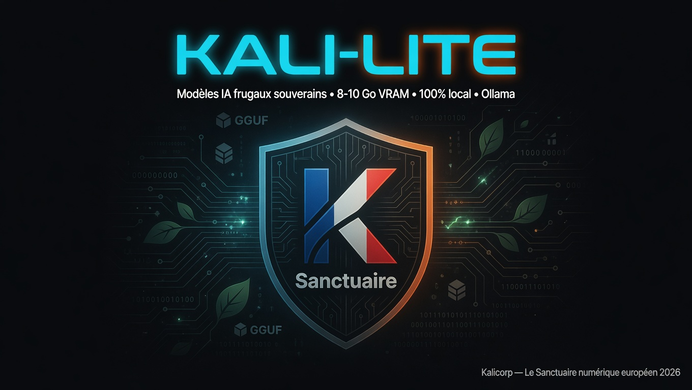
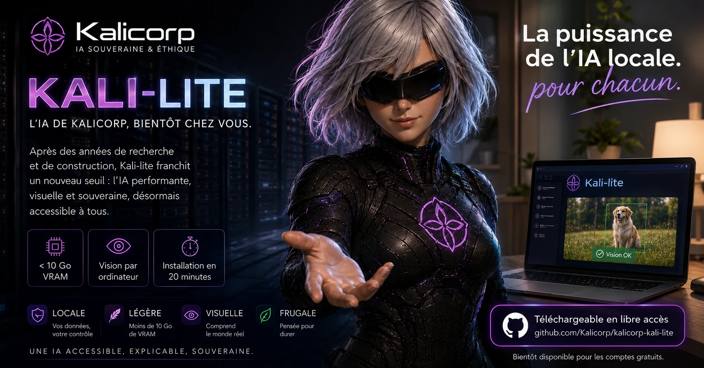

<div align="center">



# Kali-Lite

### L'intelligence artificielle locale, sans dépendance à un service d'inférence.

**Choisissez un moteur. Gardez la maîtrise de la machine, des données et du contexte.**

[](https://ollama.com)
[](LICENSE)
[](#-installation)
[](docs/WINDOWS-WSL2.md)

**[🧭 Composer mon installation](docs/CONFIGURATEUR.md)** · **[⚡ Installation rapide](#installation)** · **[🔌 Hermes Agent CLI](docs/HERMES-AGENT.md)** · **[📊 Résultats GPU](docs/BENCHMARKS.md)** · **[🗺️ Roadmap](#roadmap)**

</div>

> **Kali-Lite, ce n'est pas un modèle unique :** c'est une identité logicielle locale, une doctrine et des profils interchangeables, exécutés sous le contrôle de leur opérateur.

## 🚀 En quelques clics

| Étape | Vous choisissez | Kali-Lite prépare |
|---|---|---|
| **1 · Moteur** | Qwen3 8B, Qwen3.5 Vision, Mistral 7B, OLMo 3 7B, Gemma 4 E2B | Profil stable ou laboratoire |
| **2 · Système** | Linux, macOS ou Windows via WSL2 (pilote) | Commandes adaptées au terminal |
| **3 · Quantification** | Q4_K_M ou Q8_0 pour les variantes du laboratoire | Pull explicite et tag Ollama distinct |

**[Ouvrir le guide du configurateur →](docs/CONFIGURATEUR.md)** · Page statique locale : aucun compte, aucune télémétrie, aucune commande exécutée par le navigateur. L'hébergement GitHub Pages pourra fournir ensuite une URL directe, après activation.

**Déjà utilisateur d'Hermes Agent CLI ?** [Connecter Kali-Lite à Hermes via Ollama →](docs/HERMES-AGENT.md) — passerelle documentée, tests agentiques 64K et appels d'outils encore en attente. 

### Choisir son moteur directement dans GitHub

Ces menus natifs sont utilisables **sans quitter le README**. Ils proposent des commandes inspectables et prêtes à copier. Pour le choix croisé **moteur × OS × quantification** avec boutons *Copier*, utiliser la [page interactive](docs/CONFIGURATEUR.md).

<details>
<summary><strong>🟢 Kali-Lite Qwen3 8B — version stable (Linux / macOS)</strong></summary>

**Linux** — vérification SHA-256, simulation, puis installation volontaire :

```bash
git clone --depth 1 --branch main https://github.com/Kalicorp/kalicorp-kali-lite.git "$HOME/kali-lite-qwen"
cd "$HOME/kali-lite-qwen"
sha256sum --check SHA256SUMS
bash auto-install-kali-lite-v1-novision.sh --dry-run
```

**Si le rapport est conforme et après lecture du script, exécuter séparément :**

```bash
cd "$HOME/kali-lite-qwen"
sudo bash auto-install-kali-lite-v1-novision.sh
ollama run kali-lite
```

**macOS** — Homebrew requis, ne pas utiliser `sudo` :

```bash
git clone --depth 1 --branch main https://github.com/Kalicorp/kalicorp-kali-lite.git "$HOME/kali-lite-qwen"
cd "$HOME/kali-lite-qwen"
shasum -a 256 -c SHA256SUMS
bash auto-install-kali-lite-v1-novision.sh --dry-run
```

**Si le rapport est conforme et après lecture du script, exécuter séparément :**

```bash
cd "$HOME/kali-lite-qwen"
bash auto-install-kali-lite-v1-novision.sh
ollama run kali-lite
```

</details>

<details>
<summary><strong>🟢 Kali-Lite Vision Qwen3.5 9B — version stable (Linux / macOS)</strong></summary>

**Linux** :

```bash
git clone --depth 1 --branch main https://github.com/Kalicorp/kalicorp-kali-lite.git "$HOME/kali-lite-vision"
cd "$HOME/kali-lite-vision"
sha256sum --check SHA256SUMS
bash auto-install-kali-lite-v2-vision.sh --dry-run
```

**Si le rapport est conforme et après lecture du script, exécuter séparément :**

```bash
cd "$HOME/kali-lite-vision"
sudo bash auto-install-kali-lite-v2-vision.sh
ollama run kali-lite-v2
```

**macOS** — Homebrew requis, sans `sudo` :

```bash
git clone --depth 1 --branch main https://github.com/Kalicorp/kalicorp-kali-lite.git "$HOME/kali-lite-vision"
cd "$HOME/kali-lite-vision"
shasum -a 256 -c SHA256SUMS
bash auto-install-kali-lite-v2-vision.sh --dry-run
```

**Si le rapport est conforme et après lecture du script, exécuter séparément :**

```bash
cd "$HOME/kali-lite-vision"
bash auto-install-kali-lite-v2-vision.sh
ollama run kali-lite-v2
```

</details>

<details>
<summary><strong>🧪 Kali-Lite Mistral 7B — expérimental (Q4 / Q8)</strong></summary>

**Linux ou macOS :** Ollama doit être installé et démarré localement. Aucun `sudo` dans les recettes expérimentales.

```bash
git clone --depth 1 --branch projet-x https://github.com/Kalicorp/kalicorp-kali-lite.git "$HOME/kali-lite-mistral"
cd "$HOME/kali-lite-mistral"
```

**Q4_K_M**, plus léger :

```bash
bash scripts/kali-lite-quant.sh --dry-run mistral-7b q4
```

**Après validation de la simulation, télécharger et créer explicitement :**

```bash
ollama pull mistral:7b-instruct-v0.3-q4_K_M
bash scripts/kali-lite-quant.sh --create mistral-7b q4
ollama run kali-lite-mistral-7b-q4
```

**Q8_0**, plus gourmand en RAM et VRAM :

```bash
bash scripts/kali-lite-quant.sh --dry-run mistral-7b q8
```

**Après validation de la simulation, télécharger et créer explicitement :**

```bash
ollama pull mistral:7b-instruct-v0.3-q8_0
bash scripts/kali-lite-quant.sh --create mistral-7b q8
ollama run kali-lite-mistral-7b-q8
```

</details>

<details>
<summary><strong>🧪 Kali-Lite OLMo 3 7B — expérimental (Q4 / Q8)</strong></summary>

**Linux ou macOS :** Ollama doit être installé et démarré localement.

```bash
git clone --depth 1 --branch projet-x https://github.com/Kalicorp/kalicorp-kali-lite.git "$HOME/kali-lite-olmo"
cd "$HOME/kali-lite-olmo"
```

**Q4_K_M** :

```bash
bash scripts/kali-lite-quant.sh --dry-run olmo3-7b q4
```

**Après validation de la simulation, télécharger et créer explicitement :**

```bash
ollama pull olmo-3:7b-instruct-q4_K_M
bash scripts/kali-lite-quant.sh --create olmo3-7b q4
ollama run kali-lite-olmo3-7b-q4
```

**Q8_0** :

```bash
bash scripts/kali-lite-quant.sh --dry-run olmo3-7b q8
```

**Après validation de la simulation, télécharger et créer explicitement :**

```bash
ollama pull olmo-3:7b-instruct-q8_0
bash scripts/kali-lite-quant.sh --create olmo3-7b q8
ollama run kali-lite-olmo3-7b-q8
```

</details>

<details>
<summary><strong>🧪 Kali-Lite Gemma 4 E2B — expérimental, Vision (Q4 / Q8)</strong></summary>

**Linux ou macOS :** Ollama doit être installé et démarré localement. La vision de cette variante reste à qualifier.

```bash
git clone --depth 1 --branch projet-x https://github.com/Kalicorp/kalicorp-kali-lite.git "$HOME/kali-lite-gemma"
cd "$HOME/kali-lite-gemma"
```

**Q4_K_M** :

```bash
bash scripts/kali-lite-quant.sh --dry-run gemma4-e2b q4
```

**Après validation de la simulation, télécharger et créer explicitement :**

```bash
ollama pull gemma4:e2b-it-q4_K_M
bash scripts/kali-lite-quant.sh --create gemma4-e2b q4
ollama run kali-lite-gemma4-e2b-q4
```

**Q8_0** :

```bash
bash scripts/kali-lite-quant.sh --dry-run gemma4-e2b q8
```

**Après validation de la simulation, télécharger et créer explicitement :**

```bash
ollama pull gemma4:e2b-it-q8_0
bash scripts/kali-lite-quant.sh --create gemma4-e2b q8
ollama run kali-lite-gemma4-e2b-q8
```

</details>

<details>
<summary><strong>🔌 Hermes Agent CLI — utiliser Kali-Lite comme moteur Ollama (pilote)</strong></summary>

Hermes Agent CLI accepte l'API OpenAI-compatible d'Ollama. Pour le connecter à un **modèle Kali-Lite effectivement installé** sur l'instance locale choisie :

```bash
curl -fsS http://127.0.0.1:11434/v1/models
hermes model
```

Dans Hermes, sélectionner **Custom endpoint**, renseigner `http://127.0.0.1:11434/v1` (adapter au port réel) puis le nom exact du modèle.

**⚠️ Prérequis bloquant :** Hermes demande **au moins 64 000 tokens de contexte**. Les Modelfiles Kali-Lite actuellement publiés utilisent généralement 8K/32K, et ne sont **pas qualifiés** tels quels. Ne pas modifier la production et ne pas déclarer 64K côté Hermes sans les avoir effectivement configurés et mesurés dans Ollama.

[**Guide complet Kali-Lite × Hermes Agent CLI →**](docs/HERMES-AGENT.md) · [Documentation officielle Hermes](https://hermes-agent.nousresearch.com/docs/integrations/providers/)

</details>

<details>
<summary><strong>🪟 Windows — Ubuntu sous WSL2 (pilote non validé)</strong></summary>

Il n'existe **pas d'installateur Windows natif** dans ce dépôt. Pour tester sur un environnement Windows non critique :

**PowerShell administrateur** :

```powershell
wsl --install -d Ubuntu
wsl --update
wsl --list --verbose
```

Puis, après redémarrage éventuel et vérification de WSL2, ouvrir le terminal **Ubuntu sous WSL2**. Suivre le [guide d'installation WSL2](docs/WINDOWS-WSL2.md), installer un Ollama Linux dans WSL2 selon les recommandations officielles et utiliser l'un des parcours Linux ci-dessus seulement après `--dry-run`. **Aucune qualification WSL2 CPU/GPU n'est encore revendiquée.**

</details>

> **Avant exécution :** les recettes peuvent télécharger plusieurs Go et modifier la machine. Vérifier la provenance, la RAM/VRAM disponible, la licence amont et chaque commande. Le fichier `SHA256SUMS` atteste la cohérence de fichiers dans le dépôt, **pas** une signature d'éditeur.


---

## 🇫🇷 IA frugale & souveraine

**Kali-Lite** est une famille d'**Animas IA locales conçues par Kalicorp** pour fonctionner sur du matériel accessible, sans dépendre d'un service d'inférence cloud Kalicorp.

L'inférence s'effectue localement via **Ollama** une fois le runtime et le modèle installés.  
**Kali-Lite n'ajoute aucune télémétrie ni mécanisme de tracking utilisateur.**

Le projet ne cherche pas à masquer les limites physiques de l'IA locale. Si une machine chauffe, ralentit ou manque de mémoire, cette contrainte fait partie du système réel : CPU, GPU, RAM, VRAM et stockage restent sous le contrôle de l'opérateur.

Kali-Lite privilégie donc une approche simple :

> **Le modèle travaille pour l'utilisateur, sur une infrastructure que l'utilisateur maîtrise.**

La famille repose sur quatre couches séparables :

1. **modèle de base** ;
2. **doctrine Kali-Lite** ;
3. **spécialité optionnelle** ;
4. **harnais d'exécution**.

Cette séparation permet d'adapter une Anima, de remplacer certaines briques ou de faire évoluer le modèle de base sans devoir reconstruire toute l'architecture.

### Versions disponibles

| Version | Modèle de base | VRAM indicative | Vision | Cas d'usage | Taille indicative |
|---|---|---:|:---:|---|---:|
| **Kali-Lite** | Qwen3 8B | ~8 Go | ❌ | Chat, code, assistance système | ~5,2 Go |
| **Kali-Lite v2** | Qwen3.5 9B Vision | ~10 Go | ✅ | Images, chat, code | ~6,8 Go |

> Les besoins réels dépendent notamment de la quantification, du contexte utilisé, du runtime, du système d'exploitation et de la mémoire disponible.

### Laboratoire multi-modèles (branche `projet-x`)

| Moteur expérimental | Profil | Vision |
|---|---|:---:|
| **Mistral 7B** | `mistral-7b` | Non |
| **OLMo 3 7B** | `olmo3-7b` | Non |
| **Gemma 4 E2B** | `gemma4-e2b` | Oui (selon runtime) |

**Campagne RTX 4090 du 14 octobre 2026 : 6 configurations Q4/Q8, 18/18 smoke tests heuristiques réussis.** C'est une validation d'exécution GPU et de premiers comportements, **pas** une certification de performances ni de conformité. Qwen3 et Qwen3.5 restent les profils de référence.

<details>
<summary><strong>Voir les tests Q4 et Q8 et leurs limites</strong></summary>

| Variante | Test RTX 4090 | VRAM de processus observée |
|---|:---:|---:|
| Mistral 7B Q4 | 3/3 | 4 912 MiB |
| Mistral 7B Q8 | 3/3 | 8 282 MiB |
| OLMo 3 7B Q4 | 3/3 | 5 612 MiB |
| OLMo 3 7B Q8 | 3/3 | 9 580 MiB |
| Gemma 4 E2B Q4 | 3/3 | 3 378 MiB |
| Gemma 4 E2B Q8 | 3/3 | 4 122 MiB |

Les premiers Q4 Mistral/OLMo ont été testés avec `num_ctx=2048`, les Q8 avec `4096`. Les tâches étaient courtes. Le premier débit Gemma Q8 (~0,2 tok/s) reste à investiguer.

**[Méthode, métriques et limites de qualification →](docs/BENCHMARKS.md)**

</details>

**[Recettes Q4/Q8](docs/QUANTIZATIONS.md)** · **[Profils disponibles](docs/VARIANTS-LAB.md)**


---

<a id="installation"></a>

## ⚡ Installation

**Un moteur + un système = les commandes adaptées.** Le [configurateur](docs/CONFIGURATEUR.md) les prépare dans le navigateur sans exécution ni collecte de données. Retrouvez aussi le [guide détaillé](INSTALLATION.md).

<details open>
<summary><strong>Exemple : installer Kali-Lite Qwen3 8B sur Linux</strong></summary>

Commencer par récupérer le dépôt stable, vérifier les empreintes publiées et lancer une simulation :

```bash
git clone --depth 1 --branch main https://github.com/Kalicorp/kalicorp-kali-lite.git "$HOME/kali-lite"
cd "$HOME/kali-lite"
sha256sum --check SHA256SUMS
bash auto-install-kali-lite-v1-novision.sh --dry-run
```

**Après lecture de l'intégralité du script et validation du dry-run seulement :**

```bash
cd "$HOME/kali-lite"
sudo bash auto-install-kali-lite-v1-novision.sh
ollama run kali-lite
```

Le fichier `SHA256SUMS` n'est pas une signature de l'éditeur ; il ne protège pas contre un dépôt compromis.

</details>

<details>
<summary><strong>Autres choix : Qwen Vision, Mistral, OLMo, Gemma, macOS et WSL2</strong></summary>

Le [configurateur d'installation](docs/CONFIGURATEUR.md) prend en charge les cinq moteurs et prépare les commandes spécifiques. **Windows** se fait seulement via Ubuntu sous **WSL2**, toujours en phase pilote non certifiée ; il n'existe pas de script d'installation Windows natif.

Pour ouvrir la page localement après avoir récupéré `projet-x` :

```bash
git clone --depth 1 --branch projet-x https://github.com/Kalicorp/kalicorp-kali-lite.git "$HOME/kali-lite-config"
cd "$HOME/kali-lite-config"
python3 -m http.server 8765 --bind 127.0.0.1 --directory docs
```

Ouvrir `http://127.0.0.1:8765` dans un navigateur, puis choisir le modèle et le système. Arrêter ce petit serveur local avec `Ctrl+C`.

</details>


---

## 🛡️ Pourquoi Kali-Lite ?

- **Inférence locale** — les échanges avec le modèle sont traités localement lorsque Kali-Lite est utilisé avec Ollama local.
- **Pas de compte Kalicorp obligatoire** — aucune API Kalicorp n'est nécessaire pour faire fonctionner l'inférence locale.
- **Pas de quota commercial d'inférence** — les limites sont celles de ta machine, de ton runtime et du modèle utilisé.
- **Pas de télémétrie ajoutée par Kali-Lite** — le projet n'intègre pas de mécanisme de tracking utilisateur.
- **Architecture remplaçable** — modèle de base, doctrine et harnais sont distingués pour limiter l'enfermement technique.
- **Code et scripts inspectables** — les installateurs sont publics et leurs empreintes sont publiées.
- **Linux et macOS** — prise en charge des principaux environnements locaux ciblés par le projet.
- **Frugalité** — Kali-Lite vise des machines très éloignées des infrastructures IA de datacenter.
- **Maîtrise des données** — l'approche locale peut faciliter certaines stratégies de gouvernance, de confidentialité et de souveraineté.

<p align="center">
  
</p>

<p align="center">
  <em>Visuel de présentation — les spécifications techniques de référence sont celles de ce README et de la Model Card.</em>
</p>

### RGPD et AI Act

Un déploiement local peut réduire certains transferts de données et faciliter la maîtrise de l'infrastructure.

Il ne rend cependant **pas automatiquement une organisation conforme** au RGPD, à l'AI Act ou à toute autre réglementation.

La conformité dépend notamment :

- des usages ;
- des données traitées ;
- des responsabilités de l'opérateur ;
- des mesures techniques et organisationnelles ;
- de la gouvernance mise en place.

---

## 🖥️ Matériel testé

| Configuration | Statut |
|---|:---:|
| RTX 3080 8 Go | ✅ |
| RTX 4070 | ✅ |
| Apple Silicon M1 / M2 / M3 | ✅ |
| Kali Linux / Ubuntu | ✅ |
| macOS 11+ | ✅ |

### Ressources indicatives

**Kali-Lite**

- GPU NVIDIA : environ **8 Go de VRAM** ;
- RAM système : **16 Go minimum conseillé**.

**Kali-Lite v2**

- GPU : environ **10 Go de mémoire disponible** ;
- RAM système : **32 Go recommandé**.

Sur Apple Silicon, la mémoire est unifiée : la notion de VRAM dédiée ne s'applique donc pas exactement comme sur un GPU NVIDIA.

Une exécution CPU reste possible selon le modèle et la mémoire disponible, mais sera généralement plus lente.

---

## 📦 Cas d'usage

- assistance système Linux ;
- développement et analyse de code ;
- documentation technique ;
- audit et durcissement défensif ;
- analyse d'images avec Kali-Lite v2 ;
- formation à l'IA locale ;
- démonstration d'architectures souveraines ;
- expérimentation par des particuliers, associations, TPE, PME et collectivités.

---

## 🚫 Ce que Kali-Lite n'est pas

- ❌ un service d'inférence cloud Kalicorp ;
- ❌ une promesse d'IA sans limite physique ;
- ❌ un système automatiquement conforme au RGPD ou à l'AI Act ;
- ❌ un modèle entièrement entraîné par Kalicorp ;
- ❌ un outil conçu spécifiquement pour l'attaque offensive ;
- ❌ une garantie d'absence de réseau de toutes les dépendances tierces.

Kali-Lite utilise notamment des composants et modèles tiers tels qu'**Ollama** et **Qwen**.

Le projet cherche à les assembler de façon **locale, inspectable et remplaçable**, plutôt qu'à prétendre qu'aucune dépendance n'existe.

---

## 🧩 Architecture

Kali-Lite distingue volontairement quatre couches :

```text
┌──────────────────────────┐
│      Modèle de base      │
│        Qwen / autre      │
├──────────────────────────┤
│    Doctrine Kali-Lite    │
├──────────────────────────┤
│       Spécialité         │
│       optionnelle        │
├──────────────────────────┤
│  Harnais d'exécution     │
│ Ollama / outils / système│
└──────────────────────────┘
```

Cette architecture permet de faire évoluer une couche sans rendre tout le système dépendant d'un fournisseur unique.

**Kali-Lite n'est donc pas seulement un poids de modèle : c'est une composition documentée et reproductible.**

### Raisonnement et capacité d'action

La capacité d'un modèle à comprendre une tâche et sa capacité à réellement agir sont deux choses différentes :

```text
Comprendre une action
        ≠
Avoir l'outil
        ≠
Avoir la permission
        ≠
Avoir exécuté l'action
```

Kali-Lite est conçue pour distinguer ces états et ne pas présenter une action comme exécutée lorsqu'aucune preuve d'exécution n'est disponible.

---

## 🔐 Sécurité

Les installateurs publics peuvent être contrôlés avant exécution.

Les empreintes SHA-256 actuellement publiées sont disponibles dans :

[`SHA256SUMS`](SHA256SUMS)

Pour signaler une vulnérabilité ou consulter la politique de divulgation responsable :

[`SECURITY.md`](SECURITY.md)

Quelques principes :

- télécharger avant d'exécuter ;
- vérifier l'empreinte SHA-256 ;
- lire le script ;
- utiliser `--dry-run` lorsque disponible ;
- appliquer le principe du moindre privilège ;
- ne jamais placer de secret ou de clé API directement dans un prompt ou un fichier versionné.

---

## 📚 Documentation

| Fichier | Description |
|---|---|
| [INSTALLATION.md](INSTALLATION.md) | Guide d'installation détaillé |
| [REFACTOR_BRIEF.md](REFACTOR_BRIEF.md) | Architecture des scripts d'installation |
| [MODEL-CARD.md](MODEL-CARD.md) | Modèles de base, usages prévus et limites |
| [docs/WHY-KALI-LITE.md](docs/WHY-KALI-LITE.md) | Intention et principes de conception |
| [docs/ARCHITECTURE.md](docs/ARCHITECTURE.md) | Architecture en quatre couches |
| [templates/anima.template.md](templates/anima.template.md) | Gabarit de personnalisation d'une Anima |
| [docs/ANIMA-ADVANCED.md](docs/ANIMA-ADVANCED.md) | Identité, spécialités, mémoire et contrats d'outils |
| [docs/VARIANTS-LAB.md](docs/VARIANTS-LAB.md) | Profils Mistral / OLMo / Gemma (expérimental) |
| [docs/QUANTIZATIONS.md](docs/QUANTIZATIONS.md) | Presets Q4/Q8, tests et limites |
| [docs/WINDOWS-WSL2.md](docs/WINDOWS-WSL2.md) | Parcours Windows/WSL2 (pilote non validé sur matériel) |
| [docs/CONFIGURATEUR.md](docs/CONFIGURATEUR.md) | Page d'installation interactive locale et publication statique |
| [docs/HERMES-AGENT.md](docs/HERMES-AGENT.md) | Connexion Ollama vers Hermes Agent CLI, exigences de contexte 64K et tests d'outils |
| [docs/BENCHMARKS.md](docs/BENCHMARKS.md) | Tests multi-OS, inférence CPU GitHub et mesures GPU RTX 4090 |
| [SECURITY.md](SECURITY.md) | Sécurité et divulgation responsable |
| [SHA256SUMS](SHA256SUMS) | Empreintes SHA-256 des installateurs |
| [LICENSE](LICENSE) | GNU GPL v2 — GPL-2.0-only |

---

<a id="roadmap"></a>

## 🗺️ Roadmap 2026

- [x] Kali-Lite — Qwen3 8B
- [x] Kali-Lite v2 — modèle Vision
- [x] GitHub Actions — tests automatisés des installateurs
- [x] Organisation GitHub Kalicorp
- [x] Documentation de sécurité et Model Card
- [x] Installation Linux / macOS avec vérification SHA-256
- [ ] Support Windows / WSL2 — guide et diagnostic disponibles ; **validation réelle Windows/WSL2 CPU/GPU en attente**
- [x] Quantifications supplémentaires — recettes **Q4_K_M / Q8_0** des trois profils ; **six smoke tests réels RTX 4090, 3/3 chacun (18/18 heuristiques)**. Performances longues et comparaison contrôlée à faire.
- [x] Élargissement des modèles de base interchangeables — Mistral 7B, OLMo 3 7B, Gemma 4 E2B en **laboratoire**
- [x] Documentation de personnalisation avancée des Animas — guide, contrat d'outils et cas de validation

### Dernière étape avant clôture complète

- [ ] Tester Windows 10/11 + Ubuntu WSL2 sur machine réelle (CPU, puis GPU si disponible), installation, redémarrage et désinstallation.
- [x] Compléter le smoke test corrigé de **Gemma 4 Q4** : 3/3 heuristiques, `think=false`, 4 096 tokens de contexte, fichier JSON obtenu.
- [x] Exécuter les **trois profils Q8_0** sur RTX 4090 : Mistral, OLMo 3 et Gemma 4, 3/3 heuristiques chacun, déchargement après chaque test.
- [ ] Comparer équitablement **Q4 / Q8** sur la RTX 4090 avec les mêmes paramètres de contexte et les mêmes prompts longs, répétitions, latence, VRAM, tokens/s et fidélité à la doctrine (les six smoke tests GPU sont acquis).
- [ ] Investiguer l'anomalie de débit du **premier appel Gemma Q8** : 0,2 tok/s avec 13,184 s de temps mural.
- [ ] Promouvoir les variantes en production **uniquement après** revue humaine des résultats, licences et sécurité.

> Les cases cochées attestent de livrables **logiciels ou documentaires** ; elles ne constituent pas une homologation matérielle ou réglementaire.

---

## ⚖️ Licence

Kali-Lite est distribué sous **GNU General Public License v2.0 only (`GPL-2.0-only`)**.

Voir [`LICENSE`](LICENSE).

Les modèles de base et dépendances tierces restent soumis à leurs propres licences.

Copyright © 2026 Kalicorp.

---

<div align="center">

### Kalicorp

**Le Sanctuaire numérique européen**

IA locale • souveraineté • frugalité • maîtrise de l'infrastructure

[site.kalicorp.fr](https://site.kalicorp.fr)

</div>
